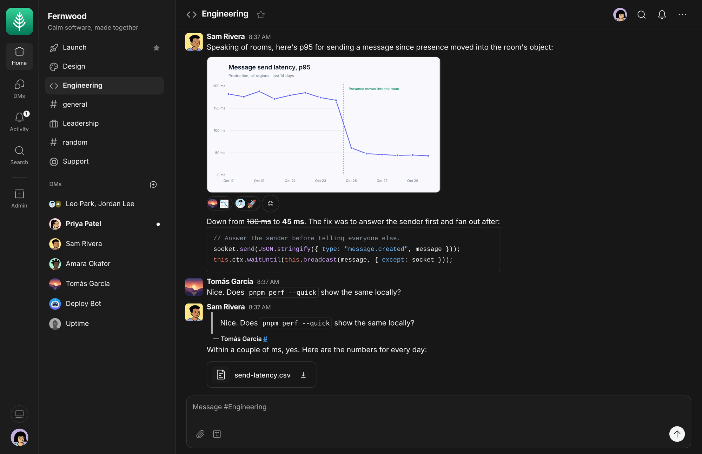

# Ember for Spacefast

Give your next project a room. Post the screenshot that explains the bug. Quote the one line everyone keeps missing.

Ember is open-source team chat with rooms, direct messages, reactions, and searchable history. This fork runs on Spacefast Zero, which handles sign-in, storage, and live updates.

See Ember running before you start a workspace of your own. [Open Ember](https://ember.space.fast/)

**Put Ember on Spacefast**

Tell your AI:

> Deploy https://github.com/Automattic/ember-spacefast to Spacefast and send me the link.

*Upstream Ember shown with a fictional team and sample conversations.*

**Take beta 3 for a spin**

- **Find the shortcuts.** Press **⌘/** or **Ctrl+/** to see what the keyboard can do.
- **Quote the good part.** Type `> ` at the start of a line to quote it and keep the rest of your reply in your own words.
- **Pick up where you left off.** When you return to a room with unread messages, look for the **New** line.

This build is based on Ember 0.5.0 beta 3. [Spacefast prerelease notes](https://github.com/Automattic/ember-spacefast/releases/tag/v0.5.0-beta.3-spacefast.1)

New attachments in private rooms and DMs can be shared with end-to-end encryption once participants enroll and verify their devices.

**What’s outside this build**

- **Huddles.** Voice, video, and screen sharing are unavailable in this edition.
- **Cloudflare Images.** Image previews are generated in the browser. Cloudflare’s server-side fallback is outside this port.
- **Upstream integrations.** Ember’s built-in GitHub update checker, AI prompt-template editor, Memberful, password accounts, and QR session transfer are unavailable here. Spacefast handles sign-in.
- **Bot files and thread reads.** Incoming Slack-compatible webhooks and outgoing text webhook replies are supported. The upstream bot APIs for reading threads and receiving or uploading files are outside this build.

Browser push and Ember AI are optional and require server-side setup.

**Built from upstream Ember**

The original app and packages are at their upstream paths. The Spacefast build lives in `spacefast/` and applies its compatibility changes to generated output. [Official Ember repository](https://github.com/NYLLON-SOFTWARE/ember-cloudflare) · [Developer setup](spacefast/README.md) · [Upstream update workflow](spacefast/UPSTREAM.md)
